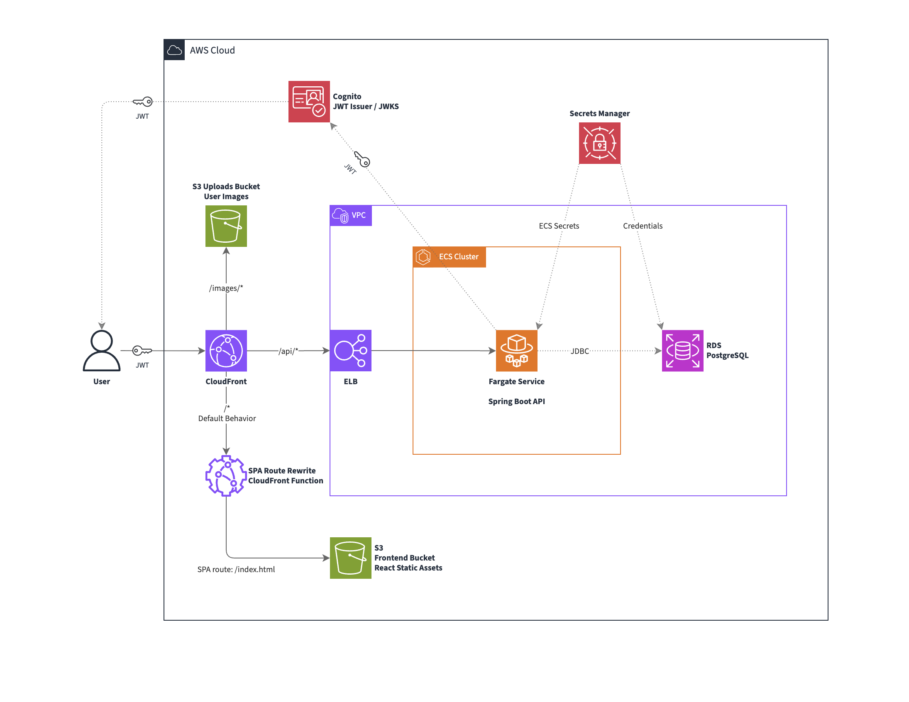
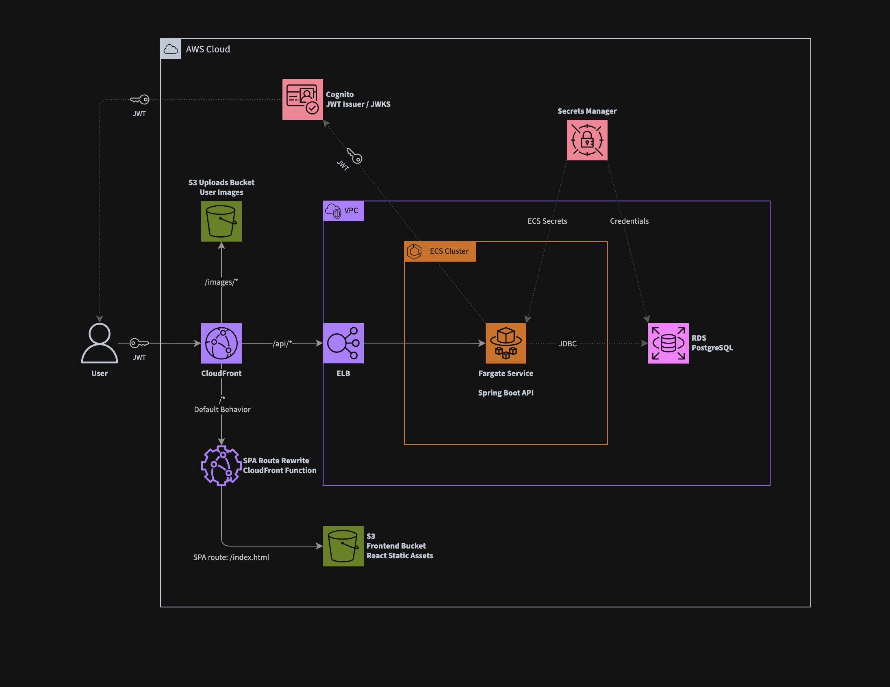

# Demo Homestays

Demo Homestays is a full-stack booking platform that allows customers to discover and book stays while giving hosts tools to manage their properties and track performance. It features secure authentication and role-based access through AWS Cognito, with a Spring Boot REST API backed by PostgreSQL. Hosts can view analytics generated from custom database queries, while the React and TypeScript frontend provides a responsive experience with efficient server-state management. The project also includes integration testing with JUnit, MockMvc, and Testcontainers to verify critical backend workflows against a real PostgreSQL environment.

## Tech Stack

- **Backend — Java / Spring Boot**: Spring Web MVC, Spring Data JPA, Spring Security, Spring OAuth2 Resource Server, Spring Validation, PostgreSQL, AWS SDK, Stripe Java SDK, JUnit, Testcontainers
- **Frontend — React / TypeScript**: Vite, React Router, TanStack Query, AWS Amplify, React Hook Form, Zod, Axios, Tailwind CSS, Leaflet
- **AWS / Infrastructure**: Amazon CloudFront, Amazon Cognito, Amazon S3, Amazon ECR, Amazon ECS, Amazon VPC, Application Load Balancer, Amazon RDS, AWS Secrets Manager, AWS CDK, Terraform, LocalStack
- **Development & Tooling**: Git, Docker, Maven, npm, Bash, Make, AWS CLI

## Architecture




## Setup Instructions

### Overview

1. [Prerequisites](#1-prerequisites)
2. [Clone the Repository](#2-clone-the-repository)
3. [Configure Secrets Manager](#3-configure-secrets-manager)
4. [Deploy the Project](#4-deploy-the-project)
5. [Seed Data](#5-seed-data)

### 1. Prerequisites

- [ Git ](#git)
- [ AWS ](#aws)
- [ IAM user with AdministratorAccess permissions policy ](#iam-user-with-administratoraccess)
- [ AWS CLI ](#aws-cli)
- [ AWS CDK ](#aws-cdk)
- [ Terraform ](#terraform)
- [ Docker ](#docker)
- [ LocalStack ](#localstack)
- [ Node.js and npm ](#nodejs-and-npm)
- [ Make and Bash ](#make-and-bash)
- [ curl ](#curl)
- [ OpenJDK 25 (LTS) and Maven ](#openjdk-25-and-maven)
- [ Stripe API Key ](#stripe-api-key)

#### Git

Install Git for your OS, then set at least your name/email (so commits are attributed correctly).

- [ Git — "Install Git." ](https://git-scm.com/install)
- [ Git — "Git Configuration." ](https://git-scm.com/book/en/v2/Customizing-Git-Git-Configuration)

#### AWS

Sign up for an AWS account (use a strong root password + MFA as part of your normal setup).

- [ AWS — "Create an AWS account." ](https://docs.aws.amazon.com/accounts/latest/reference/manage-acct-creating.html)

#### IAM user with AdministratorAccess

Create an IAM user for day-to-day use, then attach the AWS managed policy AdministratorAccess (note: broad permissions; great for development, not recommended long-term for production).

- [ AWS IAM — "Create an IAM user in your AWS account." ](https://docs.aws.amazon.com/IAM/latest/UserGuide/id_users_create.html)
- [ AWS Managed Policy Reference — "AdministratorAccess." ](https://docs.aws.amazon.com/aws-managed-policy/latest/reference/AdministratorAccess.html)

#### AWS CLI

Install AWS CLI v2 and configure credentials + default region (commonly via `aws configure`).

- [ AWS CLI — "Installing or updating the latest version of the AWS CLI." ](https://docs.aws.amazon.com/cli/latest/userguide/getting-started-install.html)
- [ AWS CLI — "Setting up the AWS CLI." ](https://docs.aws.amazon.com/cli/latest/userguide/getting-started-quickstart.html)

#### AWS CDK

Install the CDK CLI, ensure your AWS credentials/region are configured

- [ AWS CDK v2 — "Getting started with the AWS CDK." ](https://docs.aws.amazon.com/cdk/v2/guide/getting-started.html)

#### Terraform

Install Terraform, ensure your AWS credentials/region are configured

- [ Terraform — "Install | Terraform | HashiCorp Developer" ](https://developer.hashicorp.com/terraform/install)

#### Docker

Install Docker Desktop (or Docker Engine on Linux). Make sure Docker is running before you deploy.

- [ Docker Desktop — "Install Docker Desktop on Mac." ](https://docs.docker.com/desktop/setup/install/mac-install/)
- [ Docker Desktop — "Install Docker Desktop on Windows." ](https://docs.docker.com/desktop/setup/install/windows-install/)
- [ Docker Engine — "Install Docker Engine." ](https://docs.docker.com/engine/install/)

#### LocalStack

This project uses LocalStack to provide a local AWS environment. Make sure Docker is installed and configured before proceeding.

- [ LocalStack — "Installation" ](https://docs.localstack.cloud/aws/getting-started/installation/)

#### Node.js and npm

Required for frontend development. Make sure to install or update Node to version 24.x (LTS).

- [npm — "Downloading and installing Node.js and npm"](https://docs.npmjs.com/downloading-and-installing-node-js-and-npm)
- [Node.js — "Introduction to Node.js"](https://nodejs.org/learn/getting-started/introduction-to-nodejs)

#### Make and Bash

These should already be installed on most Linux distributions and MacOS. Run `make --version` and `bash --version` to check.

- [ Make Documentation ](https://www.gnu.org/software/make/)
- [ Bash Documentation ](https://www.gnu.org/software/bash/)

#### curl

Run `curl --version` to check if curl is already installed.

- [ curl - "Releases and Downloads" ](https://curl.se/download.html)

#### OpenJDK 25 and Maven

Run `java --version` to check if Java is installed.

- [ Amazon Corretto ](https://aws.amazon.com/corretto/) or [ Eclipse Temurin ](https://adoptium.net/temurin/)
- [ Apache Maven ](https://maven.apache.org/)

#### Stripe API Key

See the instructions in this document to properly add your Stripe API key to the environment.

- [ Stripe Documentation ](https://docs.stripe.com/)

### 2. Clone the Repository

Ensure all prerequisites are installed and configured before cloning the repository.

```bash
git clone https://github.com/danielhenderson01/homestays.git

cd homestays

cp .env.example .env
```

The repository includes a [Makefile](./Makefile) and supporting Bash scripts that automates most of the setup, including infrastructure, frontend, backend, and seed/test data.

### 3. Configure Secrets Manager

Configure [Secrets Manager](https://aws.amazon.com/secrets-manager/) to manage the Stripe secret key, database credentials, and seed/test user credentials. The `secrets` make target runs [secrets.sh](./scripts/secrets.sh) to create the secrets from JSON files. Creating a secret returns an ARN which is added to the generated environment for use by CDK or Terraform.

Follow the instructions below to create the JSON files before starting the deployment.

#### 1. Create JSON secrets files:

```bash
mkdir secrets && cd secrets

touch db-secret.json
touch stripe-secret.json
touch seed-host-secret.json
touch test-host-secret.json
touch test-guest-secret.json

# Restrict access to the files to only the user
chmod go-rx *.json

# Ensure the secrets are ignored by git
echo "*secret*" >> .gitignore
```

#### 2. Add your Stripe secret key:

- Log in to the Stripe Dashboard
- Navigate to API keys
- Copy your Secret Key
- Choose your preferred method (1 or 2) to add the Secret Key to `stripe-secret.json`

1. (Recommended) To hide the text from the command history:
   ```bash
   cat > stripe-secret.json
   # Type the secret as a JSON object, followed by ^D (Ctrl-D) and ^C (Ctrl-C)
   ```
2. (Easier) This text will appear in the command history:
   ```bash
   cat > stripe-secret.json << EOF
   {
     "stripe_secret_key": "your_stripe_secret_key_here"
   }
   EOF
   ```

#### 3. Create database credentials

Choose your preferred method (1 or 2) to add a username and password to `db-secret.json`:

1. (Recommended) To hide the text from the command history:
   ```bash
   cat > db-secret.json
   # Type the secret as a JSON object, followed by ^D (Ctrl-D) and ^C (Ctrl-C)
   ```
2. (Easier) This text will appear in the command history:
   ```bash
   cat > db-secret.json << EOF
   {
     "username": "your_username_here",
     "password": "your_password_here"
   }
   EOF
   ```

#### 4. Add user credentials

Add a JSON object to each of the user secrets files (preferably using a method as described in the previous steps) with the following shape:

```json
{
  "name": "your_name_here",
  "email": "your_email_here",
  "password": "your_password_here",
  "role": "your_role_here"
}
```

### 4. Deploy the Project

The infrastructure can be deployed using either CDK or Terraform.

- Set `hs_iac=cdk` or `hs_iac=terraform` in the `.env` file.
- Run `make` to print information about each individual Make target.
- Make sure Docker is running.
- Run `make deploy` to deploy everything or run an individual Make target to deploy step-by-step.

This will:

- Start LocalStack.
- Create Secrets Manager secrets.
- Build the backend image and deploy it to ECR.
- Bootstrap and deploy the infrastructure using either CDK or Terraform.
- Build the React frontend and deploy it to an S3 bucket.
- Write generated variables to `.env.generated`

### 5. Seed Data

Once deployment completes, the application is available through the CloudFront URL listed in `.env.generated`. Run `make seed` to create a host user from the information in `seed-host-secret`, upload sample images from `./data/images`, and create the properties defined in `./data/properties.json`.
